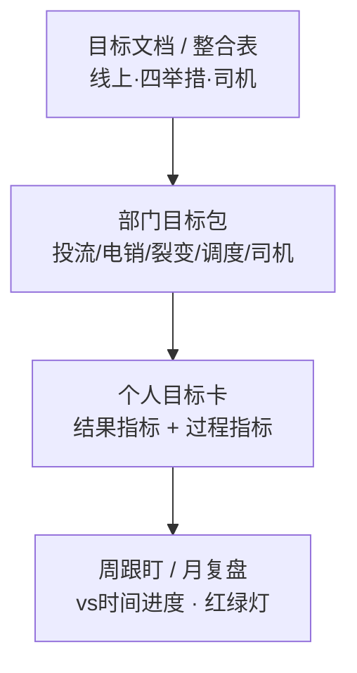

**定位**：把目标文档里的举措目标，落到试点部门与个人，形成可跟盯、可复盘的承接关系。  
**试点部门**：投流组、调度、裂变、电销、司机。  
**数源**：飞书目标文档 / 整合表（同一口径：履约剔异常、vs 时间进度）。  
**状态**：方案草稿，供讨论；人名与拆分比例待业务确认后填表。

## 一、要解决什么问题

目标现在主要停在「文档里的举措数」，业务知道部门总目标，但个人不清楚：

- 我扛哪几个指标？
- 月目标拆到我头上是多少？
- 落后时该盯漏斗哪一环？

本方案用三层承接回答上述问题：**目标文档 → 部门 → 个人**。

## 二、总体框架

| 层级 | 谁负责 | 看什么 | 更新频率 |
|---|---|---|---|
| L0 目标文档 | 目标管理（数据）维护口径与刷数 | 月目标、实际、时间进度、漏斗 | 日刷数 / 周结论 |
| L1 部门 | 部门负责人 | 本举措运单 + 关键漏斗卡点 | 周会 |
| L2 个人 | 员工 | 分到个人的结果/过程指标 | 日或周 |

原则：

1. **一个数源**：个人目标必须能回溯到目标文档同一指标，禁止另起口径。  
2. **结果 + 过程**：运单是结果；漏斗环节（如外呼、曝光→注册）是过程，用于解释为什么落后。  
3. **默认 vs 时间进度**：达成 ≥ 进度 −5pp 为正常，否则风险（与现简报一致）。  
4. **先试点再铺开**：本期只做上述五部门；裂变/调度/司机的个人拆分规则可粗，电销/投流可细。

## 三、部门 ↔ 目标文档映射

| 部门 | 目标文档板块 | 部门主结果指标（必扛） | 建议过程指标（选 2～4 个盯） |
|---|---|---|---|
| 裂变 | 营销裂变 / 货主招募 | 新增+留存运单；发货/成交货主 | 裂变系数、B 用户转化、人均发货 |
| 电销 | 电销挖潜 | 新增+留存运单；成交货主 | 外呼量/人效、接通率、认证→发货、发货→成交、单货主运单 |
| 投流 | 线上投放 | 新增+留存运单；成交货主 | 曝光、曝光→注册、注册成本、发货→成交、单货主运单 |
| 调度 | 资源转化 | 合计运单；新增/留存运单 | 发货客户数、单客户贡献；类型结构（撮合/TMS/网货）按需 |
| 司机 | 注册司机表 | 当月新增注册量（及线上注册等主路径） | 分渠道注册量、注册首单率（有数再上） |

部门负责人目标 = 本部门「主结果指标」包，对目标文档该板块 **100% 承接**（不是再砍一刀）。

## 四、从部门到个人：怎么拆

### 4.1 拆分方式（按角色选一种为主）

| 方式 | 适用 | 规则（示例） |
|---|---|---|
| A. 编制均分 | 电销坐席、同类 BD | 部门月目标 ÷ 在岗人数；新人可设保护系数（如 0.5～0.8） |
| B. 产能权重 | 人效差异大 | 按近 1～2 月人效或职级权重分摊，权和=1 |
| C. 线路/渠道包 | 投流、司机渠道运营 | 每人包一条渠道或一批计划，目标=该包在文档中的贡献假设 |
| D. 客户包 | 调度、电销大客户 | 名下客户的留存运单/发货客户；新增另立获客目标 |
| E. 暂不拆到人 | 编制未定、强协同岗 | 只留部门目标 + 个人过程动作清单，下月再拆 |

**建议试点默认**：

- **电销**：A 或 B（外呼人效已近目标，个人优先扛过程量 + 成交/单效）  
- **投流**：C（按投放计划/渠道）  
- **调度**：D（客户包）+ 部门合计兜底  
- **裂变**：A 或 C（活动/种子包）  
- **司机**：C（渠道）

### 4.2 个人目标卡（字段模板）

每人每月一张卡（可先用表格）：

| 字段 | 说明 |
|---|---|
| 姓名 / 部门 / 上级 | — |
| 统计月 | 如 2026-10 |
| 结果指标 1～2 个 | 必须来自目标文档，写清定义与月目标值 |
| 过程指标 2～4 个 | 解释结果的漏斗环节 |
| 拆分规则 | A/B/C/D + 权重或客户包说明 |
| 时间进度基准 | 与文档 O1 截止日一致 |
| 周复盘结论 | 正常/风险 + 一句卡点 |

个人目标之和应 **≈ 部门目标**（允许 ±5% 机动；超出需负责人说明）。

### 4.3 示例（示意，非定稿数）

**电销坐席（示意）**

- 结果：名下新增成交货主、单货主运单（或分摊的新增运单）  
- 过程：外呼量、接通率、认证→发货  
- 逻辑：部门新增运单目标按人效权重分摊；过程量按编制均分，避免只卷结果不做漏斗  

**投流运营（示意）**

- 结果：所负责渠道的新增运单 / 注册货主  
- 过程：曝光、曝光→注册、注册成本  
- 逻辑：渠道包目标从投流新增漏斗反拆  

## 五、运转节奏

| 节奏 | 动作 | 输出 |
|---|---|---|
| 月初 | 从目标文档锁定本月部门目标 → 负责人确认个人拆分表 | 部门目标包 + 个人目标卡 |
| 日/周 | 刷数与简报（现有链路）；部门周会看红绿灯 | 落后人/落后环节 |
| 月中 | 可微调过程指标目标，**结果指标原则上不改** | 变更记录 |
| 月末 | 复盘：达成、卡点、下月拆分是否调整 | 一页结论 |

与现有产物对齐：日简报 / QA 归因看「部门与举措」；个人表由部门维护，目标管理侧保证 **数能对上文档**。

## 六、试点落地清单（建议两周）

1. 确认五部门负责人及「主结果指标」是否认可上表。  
2. 每部门选 **1 种拆分方式**，列出在岗名单（可先 Excel）。  
3. 用 **10 月或 11 月** 做一张样表：部门目标 ← 文档；个人目标 ← 拆分。  
4. 周会试跑 1～2 次：只看个人卡红绿灯 + 漏斗卡点，不新增多套报表。  
5. 收集问题后定 v1：是否上飞书多维表、是否与绩效挂钩（本期方案 **不默认挂钩绩效**）。

## 七、边界与待确认

- 本方案管「目标承接与跟盯」，**不替代** HR 绩效制度；若要挂钩，需单独定规则。  
- 调度漏斗含类型结构时，个人是否拆到撮合/TMS/网货，由调度负责人定。  
- 投流注册/认证的「整体口径」写入个人卡时需标注，避免误解。  
- 司机目标在独立 sheet，与四举措文档并列，拆分时渠道归属需业务点名。  
- 人名、权重、客户包：**待各部门提供**，本稿不编造。

## 八、一句话

目标文档是唯一数源；五部门各接一块举措；个人用「结果+过程」小卡承接，月锁定、周跟盯、和部门目标对齐。先试点跑通表格，再考虑系统化。
